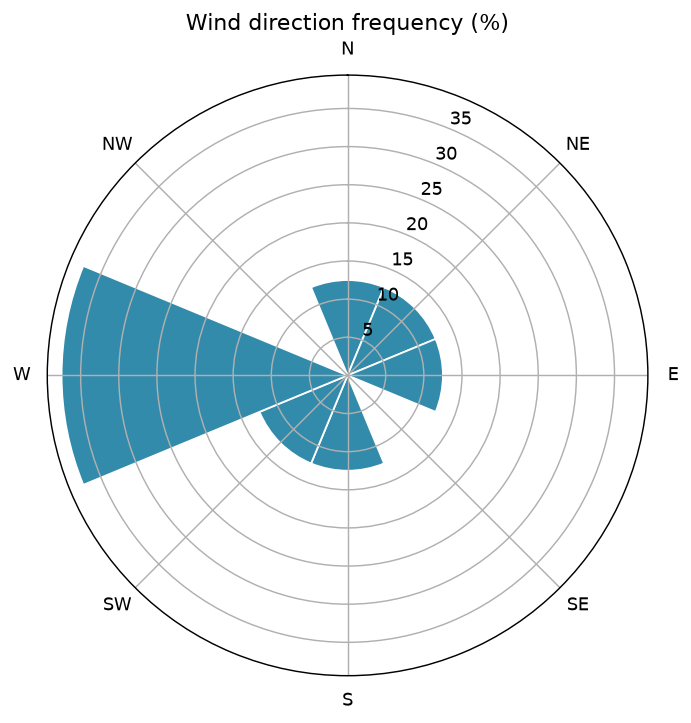
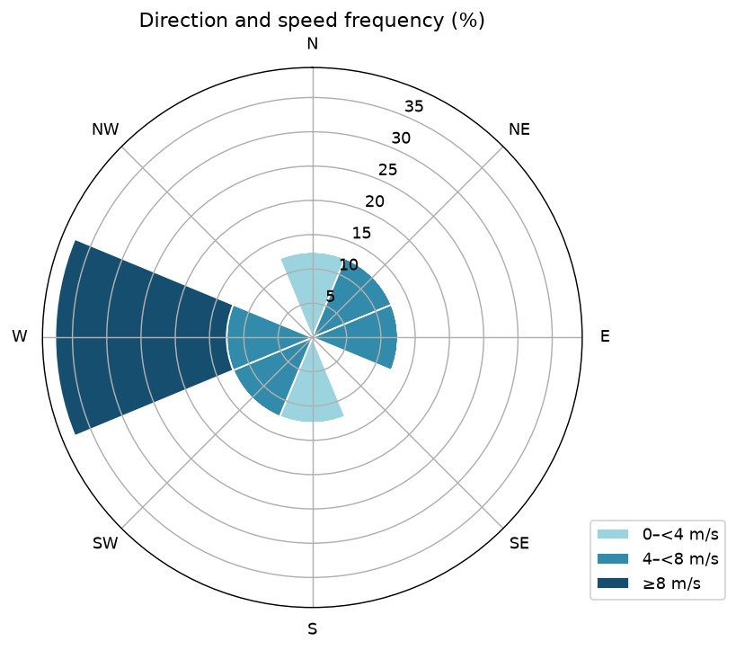
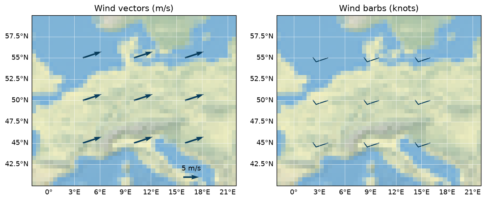

---
kernelspec:
  name: python3
  display_name: Python 3
---

# Wind

[Review the theory and worked examples](../../section6/windEnergy.md). [Download the exercise notebook](wind.ipynb).

## Chapter practice — 20 Python exercises

**4 Basic · 8 Medium · 8 Hard.** Basic exercises connect concepts, units and short calculations. Medium exercises apply functions and arrays. Hard exercises combine modelling, validation and interpretation. Each solution runs independently.

## Basic

(wind-exercise-01)=
### Exercise 01 — Rotor swept area

**Difficulty:** Basic

**Reference:** Resource and energy accounting: [@manwell2009], §§2.3–2.5; aerodynamics: §3.2.

**Task:** Calculate swept area for a 20 m radius rotor using pi r².

```{code-cell} python
# Your solution for wind exercise 01.
```

::::{dropdown} Step-by-step answer — Wind 01

1. Enter the rotor radius in metres.
2. Calculate the swept disk area.
3. Check against diameter-based area.

```{code-cell} python
import math
# Step 1: Enter the rotor radius in metres.
radius=20
# Step 2: Calculate the swept disk area.
area=math.pi*radius**2
# Step 3: Check against diameter-based area.
print(area,'m²'); assert math.isclose(area,math.pi*(2*radius)**2/4)
```

**Interpretation:** Use rotor swept area, not blade material area.

::::

(wind-exercise-02)=
### Exercise 02 — Available wind power

**Difficulty:** Basic

**Reference:** Resource and energy accounting: [@manwell2009], §§2.3–2.5; aerodynamics: §3.2.

**Task:** Use density 1.225 kg/m³, area 1000 m² and speed 8 m/s. Calculate available wind kW.

```{code-cell} python
# Your solution for wind exercise 02.
```

::::{dropdown} Step-by-step answer — Wind 02

1. Enter resource parameters in SI units.
2. Calculate kinetic-energy flux through the rotor area.
3. Check the numerical result.

```{code-cell} python
# Step 1: Enter resource parameters in SI units.
rho,area,speed=1.225,1000,8
# Step 2: Calculate kinetic-energy flux through the rotor area.
available_kw=0.5*rho*area*speed**3/1000
# Step 3: Check the numerical result.
print(available_kw,'kW'); assert abs(available_kw-313.6)<1e-10
```

**Interpretation:** 313.6 kW is available in the wind, not electrical output.

::::

(wind-exercise-03)=
### Exercise 03 — Cubic speed sensitivity

**Difficulty:** Basic

**Reference:** Resource and energy accounting: [@manwell2009], §§2.3–2.5; aerodynamics: §3.2.

**Task:** Compare available power at 5 and 10 m/s for the same rotor and density. Calculate their ratio.

```{code-cell} python
# Your solution for wind exercise 03.
```

::::{dropdown} Step-by-step answer — Wind 03

1. Store the two speeds.
2. Cancel common factors and compare cubed speeds.
3. Verify the effect of doubling speed.

```{code-cell} python
# Step 1: Store the two speeds.
low,high=5,10
# Step 2: Cancel common factors and compare cubed speeds.
ratio=high**3/low**3
# Step 3: Verify the effect of doubling speed.
print(ratio,'times'); assert ratio==8
```

**Interpretation:** A real turbine does not keep increasing output cubically above rated speed.

::::

(wind-exercise-04)=
### Exercise 04 — Aerodynamic extraction

**Difficulty:** Basic

**Reference:** Resource and energy accounting: [@manwell2009], §§2.3–2.5; aerodynamics: §3.2.

**Task:** Available wind power is 500 kW, Cp 0.4 and drivetrain efficiency 0.95. Find electrical kW and compare Cp with 16/27.

```{code-cell} python
# Your solution for wind exercise 04.
```

::::{dropdown} Step-by-step answer — Wind 04

1. Specify power and fractional conversion factors.
2. Apply aerodynamic extraction and drivetrain losses.
3. Check the ideal Betz bound and the result.

```{code-cell} python
# Step 1: Specify power and fractional conversion factors.
available,cp,efficiency=500,0.4,0.95
# Step 2: Apply aerodynamic extraction and drivetrain losses.
electrical=available*cp*efficiency
# Step 3: Check the ideal Betz bound and the result.
print(electrical,'kW electrical; C_p:',cp,'ideal Betz limit:',16/27)
assert cp<16/27 and electrical==190
```

**Interpretation:** Betz is an ideal aerodynamic limit; it is not a turbine capacity factor.

::::

## Medium

(wind-exercise-05)=
### Exercise 05 — Daily turbine capacity factor

**Difficulty:** Medium

**Reference:** Resource and energy accounting: [@manwell2009], §§2.3–2.5; aerodynamics: §3.2.

**Task:** A 3 MW turbine delivers 21.6 MWh in 24 h. Calculate daily CF.

```{code-cell} python
# Your solution for wind exercise 05.
```

::::{dropdown} Step-by-step answer — Wind 05

1. Calculate the rated energy for the same interval.
2. Divide measured energy by rated energy.
3. Print the percentage and check bounds.

```{code-cell} python
# Step 1: Calculate the rated energy for the same interval.
maximum=3*24
# Step 2: Divide measured energy by rated energy.
cf=21.6/maximum
# Step 3: Print the percentage and check bounds.
print(f'{cf:.0%}'); assert abs(cf-0.3)<1e-12
```

**Interpretation:** 30% is a period-specific utilization measure.

::::

(wind-exercise-06)=
### Exercise 06 — Hub-height adjustment

**Difficulty:** Medium

**Reference:** Height profiles: [@manwell2009], §2.3.4.2.

**Task:** Wind is 6 m/s at 10 m. Estimate at heights[10,50,100] m using v=vref(z/zref)^0.14.

```{code-cell} python
# Your solution for wind exercise 06.
```

::::{dropdown} Step-by-step answer — Wind 06

1. Store measurement height, speed and target heights.
2. Apply the assumed power-law shear profile.
3. Verify the reference height is unchanged.

```{code-cell} python
import numpy as np
# Step 1: Store measurement height, speed and target heights.
height=np.array([10,50,100]); reference=10; speed=6
# Step 2: Apply the assumed power-law shear profile.
hub=speed*(height/reference)**0.14
# Step 3: Verify the reference height is unchanged.
print(hub,'m/s'); assert hub[0]==6 and np.all(np.diff(hub)>0)
```

**Interpretation:** The exponent is illustrative and not universal across terrain and atmospheric stability.

::::

(wind-exercise-07)=
### Exercise 07 — Density sensitivity

**Difficulty:** Medium

**Reference:** Resource and energy accounting: [@manwell2009], §§2.3–2.5; aerodynamics: §3.2.

**Task:** At fixed area 1000 m² and 8 m/s, compare available kW for densities[1.0,1.225,1.3] kg/m³.

```{code-cell} python
# Your solution for wind exercise 07.
```

::::{dropdown} Step-by-step answer — Wind 07

1. Store candidate air densities.
2. Keep geometry and speed fixed.
3. Check proportionality with density.

```{code-cell} python
import numpy as np
# Step 1: Store candidate air densities.
rho=np.array([1.0,1.225,1.3])
# Step 2: Keep geometry and speed fixed.
power=0.5*rho*1000*8**3/1000
# Step 3: Check proportionality with density.
print(power,'kW'); assert np.allclose(power/power[0],rho/rho[0])
```

**Interpretation:** This checks available wind power; manufacturer electrical curves require their specified density treatment.

::::

(wind-exercise-08)=
### Exercise 08 — Piecewise turbine curve

**Difficulty:** Medium

**Reference:** Resource and energy accounting: [@manwell2009], §§2.3–2.5; aerodynamics: §3.2. Cubic ramp is a teaching approximation, not a measured curve.

**Task:** Implement 3 MW rated power: zero below 3 m/s, 3(v³−3³)/(12³−3³) between 3 and 12, rated to below 25, zero thereafter. Test[0,3,6,12,25].

```{code-cell} python
# Your solution for wind exercise 08.
```

::::{dropdown} Step-by-step answer — Wind 08

1. Define a vectorised curve with explicit operating boundaries.
2. Evaluate boundary and intermediate speeds.
3. Check key thresholds and print MW.

```{code-cell} python
import numpy as np
# Step 1: Define a vectorised curve with explicit operating boundaries.
def curve(values):
    v=np.asarray(values,dtype=float)
    if np.any(~np.isfinite(v)) or np.any(v<0): raise ValueError('Invalid wind speed')
    return np.where((v>=3)&(v<12),3*(v**3-3**3)/(12**3-3**3),np.where((v>=12)&(v<25),3.,0.))
# Step 2: Evaluate boundary and intermediate speeds.
power=curve([0,3,6,12,25])
# Step 3: Check key thresholds and print MW.
print(power,'MW'); assert np.allclose(power[[0,1,3,4]],[0,0,3,0])
```

**Interpretation:** Cut-out is a shutdown boundary; the idealised curve omits control hysteresis.

::::

(wind-exercise-09)=
### Exercise 09 — Power of mean versus mean power

**Difficulty:** Medium

**Reference:** Resource and energy accounting: [@manwell2009], §§2.3–2.5; aerodynamics: §3.2.

**Task:** Compare the mean of v³ with the cube of mean speed for speeds[4,8] m/s.

```{code-cell} python
# Your solution for wind exercise 09.
```

::::{dropdown} Step-by-step answer — Wind 09

1. Store equal-duration wind observations.
2. Compare averaging before and after the nonlinear transformation.
3. Print the discrepancy and check its direction.

```{code-cell} python
import numpy as np
# Step 1: Store equal-duration wind observations.
v=np.array([4,8])
# Step 2: Compare averaging before and after the nonlinear transformation.
mean_cube=np.mean(v**3); cube_mean=np.mean(v)**3
# Step 3: Print the discrepancy and check its direction.
print(mean_cube,cube_mean,'m³/s³; difference:',mean_cube-cube_mean,'m³/s³')
assert mean_cube==288 and cube_mean==216
```

**Interpretation:** Using mean speed in a nonlinear power model can bias energy estimates; clipping adds further effects.

::::

(wind-exercise-10)=
### Exercise 10 — Turbulence intensity

**Difficulty:** Medium

**Reference:** Turbulence intensity: [@manwell2009], §2.3; population standard deviation is explicitly assumed.

**Task:** For[6,8,10] m/s, calculate population standard deviation divided by mean speed. State ddof=0.

```{code-cell} python
# Your solution for wind exercise 10.
```

::::{dropdown} Step-by-step answer — Wind 10

1. Define the observations and statistical convention.
2. Divide population standard deviation by nonzero mean.
3. Check and print the dimensionless ratio.

```{code-cell} python
import numpy as np
# Step 1: Define the observations and statistical convention.
v=np.array([6,8,10]); mean=v.mean()
# Step 2: Divide population standard deviation by nonzero mean.
ti=v.std(ddof=0)/mean
# Step 3: Check and print the dimensionless ratio.
print(f'TI: {ti:.2%}'); assert np.isclose(ti,np.sqrt(8/3)/8)
```

**Interpretation:** Three samples demonstrate the calculation; they do not meet a field measurement campaign specification.

::::

(wind-exercise-11)=
### Exercise 11 — Circular mean direction

**Difficulty:** Medium

**Reference:** Circular mean and zero-resultant limitation: [SciPy circmean](https://docs.scipy.org/doc/scipy/reference/generated/scipy.stats.circmean.html).

**Task:** Calculate the equal-weight circular mean of[350,10,0] degrees clockwise from north.

```{code-cell} python
# Your solution for wind exercise 11.
```

::::{dropdown} Step-by-step answer — Wind 11

1. Convert angles to radians before trigonometry.
2. Average sine and cosine and recover a compass angle.
3. Verify north in the half-open compass range.

```{code-cell} python
import numpy as np
# Step 1: Convert angles to radians before trigonometry.
angle=np.deg2rad([350,10,0])
# Step 2: Average sine and cosine and recover a compass angle.
s=np.sin(angle).mean(); c=np.cos(angle).mean()
mean=np.round(np.degrees(np.arctan2(s,c))%360,12)%360
# Step 3: Verify north in the half-open compass range.
print(mean,'degrees'); assert 0<=mean<360 and np.isclose(mean,0)
```

**Interpretation:** An arithmetic mean would be misleading across the north/360° boundary.

::::

(wind-exercise-12)=
### Exercise 12 — Compass sector counts

**Difficulty:** Medium

**Reference:** Direction-sector convention specified in this exercise; [@manwell2009], Chapter 2; Array calculations: [@numpyDocs].

**Task:** Bin directions[350,0,20,45,90,180,270] into eight sectors centered on N,NE,E,SE,S,SW,W,NW.

```{code-cell} python
# Your solution for wind exercise 12.
```

::::{dropdown} Step-by-step answer — Wind 12

1. Shift by half a sector so north straddles zero degrees.
2. Count each sector including empty ones.
3. Check all records are counted and north has three.

```{code-cell} python
import numpy as np
# Step 1: Shift by half a sector so north straddles zero degrees.
direction=np.array([350,0,20,45,90,180,270]); sector=((direction+22.5)%360//45).astype(int)
# Step 2: Count each sector including empty ones.
counts=np.bincount(sector,minlength=8)
# Step 3: Check all records are counted and north has three.
print(dict(zip(['N','NE','E','SE','S','SW','W','NW'],counts)))
assert counts.sum()==7 and counts[0]==3
```

**Interpretation:** These are frequency counts, not energy-weighted wind-rose sectors.

::::

## Hard

(wind-exercise-13)=
### Exercise 13 — Combined availability and losses

**Difficulty:** Hard

**Reference:** Resource and energy accounting: [@manwell2009], §§2.3–2.5; aerodynamics: §3.2.

**Task:** Two equally long seasons offer 7 and 3 GWh gross. Their availability is 90% and 100%, and retained wake energy is 0.85 and 0.99. Reconcile a sequential loss budget by season and compare against applying mean factors to annual gross energy.

```{code-cell} python
# Your solution for wind exercise 13.
```

::::{dropdown} Step-by-step answer — Wind 13

1. Store independent retained-energy assumptions.
2. Apply each factor once.
3. Check net energy and show the total loss fraction.

```{code-cell} python
import numpy as np
# Step 1: Store independent retained-energy assumptions.
gross=np.array([7,3]); availability=np.array([.9,1]); wake_retained=np.array([.85,.99])
# Step 2: Apply each factor once.
online=gross*availability
offline=gross-online
net=online*wake_retained
wake=online-net
# Step 3: Check net energy and show the total loss fraction.
aggregate=gross.sum()*availability.mean()*wake_retained.mean()
for i,(g,off,w,n) in enumerate(zip(gross,offline,wake,net),1):
    print(f'Season {i}: gross {g:.3f}, offline {off:.3f}, wake {w:.3f}, net {n:.3f} GWh')
print(f'Seasonal net total: {net.sum():.3f} GWh; mean-factor estimate: {aggregate:.3f} GWh')
print(f'Total sequential loss fraction: {(offline.sum()+wake.sum())/gross.sum():.2%}')
assert np.allclose(net+offline+wake,gross) and net.sum()<aggregate
```

**Interpretation:** Avoid applying a loss twice when an input power curve or energy estimate is already net of it.

::::

(wind-exercise-14)=
### Exercise 14 — Unequal operating intervals

**Difficulty:** Hard

**Reference:** Power, energy and conversion: [@wade2003], Chapter 2; [@jica2011], §3.1.2 (use coherent SI units).

**Task:** Mean powers [0.5,2,3] MW last [2,1,0.5] h. Write a function for energy and realised capacity factor at 3 MW. Compare with the biased result obtained if you assume each interval lasts the mean duration. Reject mismatched inputs and out-of-rating power.

```{code-cell} python
# Your solution for wind exercise 14.
```

::::{dropdown} Step-by-step answer — Wind 14

1. Store aligned power and duration values.
2. Integrate and use the same duration in the capacity-factor denominator.
3. Check the hand sum and report results.

```{code-cell} python
import numpy as np
# Step 1: Store aligned power and duration values.
p=np.array([0.5,2,3]); dt=np.array([2,1,0.5])
# Step 2: Integrate and use the same duration in the capacity-factor denominator.
def metrics(p,dt,rating):
    p,dt=np.asarray(p,dtype=float),np.asarray(dt,dtype=float)
    if (p.ndim!=1 or p.size==0 or p.shape!=dt.shape or not np.isfinite(rating) or rating<=0
            or not np.isfinite(p).all() or not np.isfinite(dt).all()
            or np.any(dt<=0) or np.any((p<0)|(p>rating))):
        raise ValueError('Provide finite aligned power, positive durations and a positive rating')
    energy=np.sum(p*dt)
    return energy,energy/(rating*dt.sum())
# Step 3: Check the hand sum and report results.
energy,cf=metrics(p,dt,3)
wrong,wrong_cf=metrics(p,np.full(p.shape,dt.mean()),3)
print(energy,cf,wrong,wrong_cf,'actual MWh and CF, then equal-interval estimates')
assert energy==4.5 and 0<=cf<wrong_cf<=1
```

**Interpretation:** Weight each interval-average power by its duration. Use the same total duration in the capacity-factor denominator.

::::

(wind-exercise-15)=
### Exercise 15 — Histogram of wind speeds

**Difficulty:** Hard

**Reference:** Wind statistics: [@manwell2009], §2.4; [@matplotlibDocs].

**Task:** Eight one-hour winds [0,2,4,6,8,10,12,14] m/s use bins [0,5,10,15]. Compare observation count and energy by bin using a 3 MW turbine with 3/12/25 m/s thresholds and the chapter cubic ramp. Plot both distributions and reconcile total MWh.

```{code-cell} python
# Your solution for wind exercise 15.
```

::::{dropdown} Step-by-step answer — Wind 15

1. Specify speeds and bin edges.
2. Count observations and plot frequency.
3. Check bin counts and completeness.

```{code-cell} python
import numpy as np
import matplotlib.pyplot as plt
# Step 1: Specify speeds and bin edges.
speed=np.array([0,2,4,6,8,10,12,14]); edges=[0,5,10,15]
# Step 2: Count observations and plot frequency.
power=np.where((speed>=3)&(speed<12),3*(speed**3-27)/(1728-27),np.where((speed>=12)&(speed<25),3,0))
counts,_=np.histogram(speed,bins=edges)
energy,_=np.histogram(speed,bins=edges,weights=power*1.0)
fig,axes=plt.subplots(1,2,figsize=(8,3))
for ax, values, units in zip(axes,[counts,energy],['Observations','Energy (MWh)']):
    ax.stairs(values,edges); ax.set(xlabel='Wind speed (m/s)',ylabel=units)
fig.tight_layout(); plt.show()
# Step 3: Check bin counts and completeness.
print(counts,energy,'observations and MWh')
assert np.array_equal(counts,[3,2,3]) and np.isclose(energy.sum(),power.sum()) and energy.argmax()==2
```

**Interpretation:** A frequency histogram uses counts; probability density would have a different vertical-axis unit.

::::

(wind-exercise-16)=
### Exercise 16 — Weibull annual energy and convergence

**Difficulty:** Hard

**Reference:** Wind distribution and energy: [@manwell2009], §§2.4–2.5; [SciPy Weibull density](https://docs.scipy.org/doc/scipy/reference/generated/scipy.stats.weibull_min.html).

**Task:** Use Weibull shape 2, scale 8 m/s and the 3/12/25 m/s,3 MW curve. Integrate using midpoint powers and CDF bin probabilities over 0–30 m/s. Compare bin widths 0.1 and 0.05; apply 8760 h and net factor 0.9.

```{code-cell} python
# Your solution for wind exercise 16.
```

::::{dropdown} Step-by-step answer — Wind 16

1. Define the curve and exact bin probabilities from the Weibull CDF.
2. Refine the integration grid.
3. Check convergence and capacity limits.

```{code-cell} python
import numpy as np
# Step 1: Define the curve and exact bin probabilities from the Weibull CDF.
def aep(step):
    edges=np.arange(0,30+step/2,step); mid=(edges[:-1]+edges[1:])/2
    probability=np.diff(1-np.exp(-(edges/8)**2))
    p=np.where((mid>=3)&(mid<12),3*(mid**3-27)/(1728-27),np.where((mid>=12)&(mid<25),3,0))
    return np.sum(p*probability)*8760*0.9/1000
# Step 2: Refine the integration grid.
coarse,fine=aep(0.1),aep(0.05)
# Step 3: Check convergence and capacity limits.
print(coarse,fine,'GWh; relative difference:',abs(coarse-fine)/fine)
assert abs(coarse-fine)/fine<0.001 and 0<fine<3*8760/1000
```

**Interpretation:** Probability above30 m/s has zero output under this shutdown curve; its omission does not remove generating energy.

::::

(wind-exercise-17)=
### Exercise 17 — Undefined circular means

**Difficulty:** Hard

**Reference:** Circular mean and zero-resultant limitation: [SciPy circmean](https://docs.scipy.org/doc/scipy/reference/generated/scipy.stats.circmean.html).

**Task:** Write a direction-mean function returning degrees in [0, 360), rejecting empty/nonfinite data and resultant length below 1e−8. Verify [90, 270] is undefined and [350, 10] is north.

```{code-cell} python
# Your solution for wind exercise 17.
```

::::{dropdown} Step-by-step answer — Wind 17

1. Validate input angles and compute the mean vector.
2. Verify cancellation is explicitly reported.
3. Verify the well-defined northward sample.

```{code-cell} python
import numpy as np
# Step 1: Validate input angles and compute the mean vector.
def mean_direction(values):
    a=np.asarray(values,dtype=float)
    if a.size==0 or np.any(~np.isfinite(a)): raise ValueError('Need finite directions')
    s=np.sin(np.deg2rad(a)).mean(); c=np.cos(np.deg2rad(a)).mean()
    if np.hypot(s,c)<1e-8: raise ValueError('Undefined mean direction')
    angle=np.degrees(np.arctan2(s,c))%360
    return 0.0 if angle == 360 else angle
# Step 2: Verify cancellation is explicitly reported.
try: mean_direction([90,270])
except ValueError: print('Opposite directions: undefined mean')
else: raise AssertionError('Cancellation was not detected')
# Step 3: Verify the well-defined northward sample.
answer=mean_direction([350,10]); assert 0 <= answer < 360 and min(answer,360-answer)<1e-8
print(answer,'degrees')
```

**Interpretation:** A near-zero resultant is not evidence for a meaningful northward average.

::::

(wind-exercise-18)=
### Exercise 18 — Fit shear from multiple heights

**Difficulty:** Hard

**Reference:** Power-law shear: [@manwell2009], §2.3.4.2; logarithmic least squares is the stated estimator.

**Task:** Synthetic speeds at heights[20,40,80] m are generated by 6(z/20)^0.2. Fit log(v) against log(z/20) and predict at 100 m.

```{code-cell} python
# Your solution for wind exercise 18.
```

::::{dropdown} Step-by-step answer — Wind 18

1. Build synthetic multi-height observations.
2. Estimate exponent and reference speed by log-linear regression.
3. Recover the known synthetic parameters.

```{code-cell} python
import numpy as np
# Step 1: Build synthetic multi-height observations.
height=np.array([20,40,80]); speed=6*(height/20)**0.2
# Step 2: Estimate exponent and reference speed by log-linear regression.
alpha,intercept=np.polyfit(np.log(height/20),np.log(speed),1)
prediction=np.exp(intercept)*(100/20)**alpha
# Step 3: Recover the known synthetic parameters.
print('Alpha:',alpha,'100 m wind:',prediction,'m/s')
assert np.isclose(alpha,0.2) and np.isclose(np.exp(intercept),6)
```

**Interpretation:** Three heights provide a fit and consistency check; real profiles require concurrent quality-controlled measurements.

::::

(wind-exercise-19)=
### Exercise 19 — Compare hub heights on energy

**Difficulty:** Hard

**Reference:** Resource and energy accounting: [@manwell2009], §§2.3–2.5; aerodynamics: §3.2.

**Task:** At 10 m, speeds[3,5,7,9] m/s last 6 h each. Compare hub heights 50 and 100 m using exponent 0.14 and the 3 MW piecewise curve. Calculate daily MWh, not power from mean speed.

```{code-cell} python
# Your solution for wind exercise 19.
```

::::{dropdown} Step-by-step answer — Wind 19

1. Define the common example speeds and a turbine model.
2. Adjust each interval to each candidate hub height.
3. Check rated bounds and compare the designs.

```{code-cell} python
import numpy as np
# Step 1: Define the common example speeds and a turbine model.
vref=np.array([3,5,7,9])
def curve(v):
    v = np.asarray(v, dtype=float)
    if not np.isfinite(v).all() or (v < 0).any():
        raise ValueError("Wind speeds must be finite and non-negative")
    return np.where((v>=3)&(v<12),3*(v**3-27)/(1728-27),np.where((v>=12)&(v<25),3,0))
# Step 2: Adjust each interval to each candidate hub height.
energy={height:float(curve(vref*(height/10)**0.14).sum()*6) for height in [50,100]}
# Step 3: Check rated bounds and compare the designs.
print(energy,'MWh'); assert all(0<=e<=72 for e in energy.values())
```

**Interpretation:** Higher towers change cost and loads. More energy in this sample does not prove economic superiority; a higher hub can also reach cut-out and produce less for other winds.

::::

(wind-exercise-20)=
### Exercise 20 — Bootstrap a sample mean power

**Difficulty:** Hard

**Reference:** Bootstrap sampling: [SciPy bootstrap](https://docs.scipy.org/doc/scipy/reference/generated/scipy.stats.bootstrap.html). If using SciPy, select `method="percentile"`; its default is BCa. Different random draws or implementations can produce different endpoints. Independence is assumed here; serial wind data may require block resampling.

**Task:** Observed daily-average powers [0.4, 0.8, 1.2, 0.6, 1.5, 1.0] MW are treated as independent. With seed 11, draw 2000 equal-sized samples with replacement and calculate a percentile 95% interval for mean MW.

```{code-cell} python
# Your solution for wind exercise 20.
```

::::{dropdown} Step-by-step answer — Wind 20

1. Set observations and a reproducible random generator.
2. Resample observations with replacement and average each sample.
3. Check interval order and report the sampling assumptions.

```{code-cell} python
import numpy as np
# Step 1: Set observations and a reproducible random generator.
p=np.array([0.4,0.8,1.2,0.6,1.5,1.0]); rng=np.random.default_rng(11)
# Step 2: Resample observations with replacement and average each sample.
means=rng.choice(p,size=(2000,len(p)),replace=True).mean(axis=1)
interval=np.quantile(means,[0.025,0.975])
# Step 3: Check interval order and report the sampling assumptions.
print('Sample mean:',p.mean(),'MW; bootstrap interval:',interval,'MW')
assert interval[0]<interval[1] and means.min()>=p.min() and means.max()<=p.max()
```

**Interpretation:** Six days are insufficient for a bankable resource estimate. Serial dependence would require a suitable block bootstrap or another model.

::::

## Python Visualization: Wind Direction

These original examples use **synthetic data** and are inspired by the saved videos [How to make a wind rose with Python](https://youtu.be/UdMCWf6WuK4), [How to make a wind rose plot with Python](https://youtu.be/g-MmDTbx8kI), and [Overlay Wind Barbs and Wind Vectors on a Map](https://youtu.be/1Nr9KW89lCc). They illustrate the topics rather than reproduce the videos' code or data. The wind-rose examples use NumPy and Matplotlib and can run in this course's browser workspace. The map example also uses Cartopy, which is available in the tested browser runtime; package or map asset availability may change.

**Direction convention:** meteorological direction is the direction the wind comes **from**, clockwise from north: N = 0°, E = 90°, S = 180°, W = 270°. Arrows in a vector map instead point **toward** the direction of airflow. Exclude or separately report calm winds, for which direction is undefined. [ECMWF wind conventions](https://confluence.ecmwf.int/pages/viewpage.action?pageId=212441203).

When transferring formulas between NumPy and a spreadsheet, check `atan2` argument order and test cardinal directions. Excel takes x before y; NumPy takes y before x. The current ECMWF page checked on 19 November 2026 differed from the linked 2021 spreadsheet expression, so verify the target formula rather than copying it untested.

### 1. A simple frequency wind rose

The example assigns each observation to its nearest 45° compass sector. Eight equally spaced samples make it easy to inspect the result. Frequencies use all eight valid non-calm observations as their denominator.

```{code-cell} python
import numpy as np
import matplotlib.pyplot as plt

directions = np.array([0, 45, 90, 180, 225, 270, 270, 270])  # from degrees
sector = ((directions + 22.5) // 45).astype(int) % 8
percent = np.bincount(sector, minlength=8) / len(directions) * 100
labels = ['N', 'NE', 'E', 'SE', 'S', 'SW', 'W', 'NW']
angles = np.arange(8) * 2 * np.pi / 8

fig, ax = plt.subplots(figsize=(6, 6), subplot_kw={'projection': 'polar'})
ax.set_theta_zero_location('N')
ax.set_theta_direction(-1)
ax.bar(angles, percent, width=2*np.pi/8, color='#328baa', edgecolor='white')
ax.set_xticks(angles, labels)
ax.set_title('Wind direction frequency (%)')
print('N: {:.1f}%; W: {:.1f}%'.format(percent[0], percent[6]))
plt.show()
```

**Expected output:** `N: 12.5%; W: 37.5%`. The west sector is tallest; SE and NW have no observations.



### 2. Wind rose with speed categories

Stack speed ranges within each directional sector. The example uses the same directions and eight synthetic speeds. Each colored segment is a percentage of **all valid observations**, so the heights of all segments together sum to 100%.

```{code-cell} python
import numpy as np
import matplotlib.pyplot as plt

direction = np.array([0, 45, 90, 180, 225, 270, 270, 270])
speed = np.array([3, 5, 7, 2, 4, 6, 8, 10])  # m/s
sector = ((direction + 22.5) // 45).astype(int) % 8
edges = [0, 4, 8, np.inf]
angles = np.arange(8) * np.pi / 4
colors = ['#9bd3df', '#328baa', '#164e70']
labels = ['0–<4 m/s', '4–<8 m/s', '≥8 m/s']
bottom = np.zeros(8)

fig, ax = plt.subplots(figsize=(6, 6), subplot_kw={'projection': 'polar'})
ax.set_theta_zero_location('N')
ax.set_theta_direction(-1)
for low, high, color, label in zip(edges[:-1], edges[1:], colors, labels):
    count = np.bincount(sector[(speed >= low) & (speed < high)], minlength=8)
    percentage = count / len(speed) * 100
    ax.bar(angles, percentage, width=np.pi/4, bottom=bottom,
           color=color, edgecolor='white', label=label)
    bottom += percentage
ax.set_xticks(angles, ['N', 'NE', 'E', 'SE', 'S', 'SW', 'W', 'NW'])
ax.set_title('Direction and speed frequency (%)')
ax.legend(loc='lower left', bbox_to_anchor=(1.0, 0.0))
print('Total observations:', len(speed), '| Total frequency:', bottom.sum(), '%')
plt.show()
```

**Expected output:** `Total observations: 8 | Total frequency: 100.0 %`. The west sector is 37.5%, with 12.5% in the 4–<8 m/s band and 25% in the ≥8 m/s band.



### 3. Wind vectors and barbs on a map

This Python example plots a small **synthetic** Europe-region grid on Cartopy's bundled low-resolution background. `u` is eastward and `v` northward, in m/s. Arrows show where air is going; barbs use **knots** here (1 m/s ≈ 1.94384 knots). A full barb denotes 10 knots and a half barb 5 knots, rounded to the nearest 5 by the plotting convention. The background is a visual reference, not a site survey.

In a local environment, install `numpy matplotlib cartopy`. The tested browser workspace can load Cartopy; its availability and map assets depend on the runtime and network. The pre-rendered result below provides a reference. Use `transform=ccrs.PlateCarree()` because the input positions are longitude and latitude. For real gridded data, check the coordinate system and whether vector components must be rotated into east/north.

```{code-cell} python
import numpy as np
import matplotlib.pyplot as plt
import cartopy.crs as ccrs

lon, lat = np.meshgrid([4, 10, 16], [45, 50, 55])
u = np.full(lon.shape, 6.0)   # eastward m/s
v = np.full(lat.shape, 2.0)   # northward m/s
speed = np.hypot(u, v)
projection = ccrs.PlateCarree()
fig, axes = plt.subplots(1, 2, figsize=(10, 4),
                         subplot_kw={'projection': projection})
for ax in axes:
    ax.set_extent([-2, 22, 40, 60], crs=projection)
    ax.stock_img()
    ax.gridlines(draw_labels={'bottom': 'x', 'left': 'y'},
                 linewidth=0.5, color='white', alpha=0.7)
arrows = axes[0].quiver(lon, lat, u, v, transform=projection,
                        color='#083d5c', scale=65)
axes[0].quiverkey(arrows, 0.78, 0.05, 5, '5 m/s', coordinates='axes')
axes[0].set_title('Wind vectors (m/s)')
axes[1].barbs(lon, lat, u*1.94384, v*1.94384, transform=projection,
              color='#083d5c', length=6)
axes[1].set_title('Wind barbs (knots)')
print('Speed: {:.2f} m/s'.format(speed[0, 0]))
plt.tight_layout()
plt.show()
```

**Expected output:** `Speed: 6.32 m/s`. Nine equal arrows point northeast; the barbs show the same synthetic flow in knots.



Use [Wind data and calculations](../../section5/wind-data.md) for ERA5 access, the pywind notebooks and an energy calculation. For measured data, inspect units, direction convention, timestamps, missing values and the representativeness of the site before making a wind rose.
